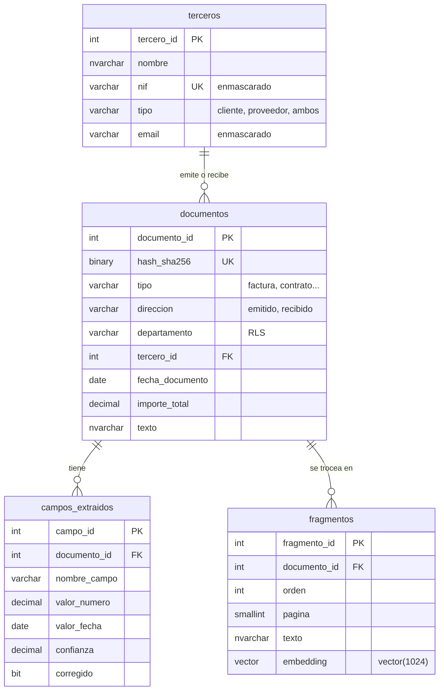

# Arquitectura

## Componentes

| Componente | Papel | Dónde |
|---|---|---|
| SQL Server 2025 | Datos, lógica, seguridad, vectores y orquestación de la IA | Instancia local (`.\SQL2025` o `localhost`) |
| Ollama | Ejecuta los modelos | `http://localhost:11434` |
| bge-m3 | Embeddings de 1024 dimensiones, multilingüe | Ollama |
| qwen3:4b-instruct | Clasificación, extracción de campos y respuestas RAG | Ollama |
| Caddy | Expone Ollama por HTTPS, que es lo único que acepta SQL Server | `https://localhost:11435` |

Nada sale del ordenador.

## Modelo de datos



Además: `auditoria` (la llenan triggers), `consultas_rag` (traza de cada pregunta) y `config_ia` (modelos y URLs).

## Flujo 1: ingesta con IA

```
Texto del documento
   │  usp_archivar_documento        hash SHA-256: si ya existe, no se duplica
   ▼
documentos (tipo = sin_clasificar)
   │  usp_clasificar_y_extraer      qwen3:4b-instruct + JSON Schema -> JSON
   │                                T-SQL valida: tipos, fecha, base + IVA = total
   │                                fn_buscar_tercero: NIF o nombre aproximado (Jaro-Winkler)
   ▼
documentos + campos_extraidos
   │  usp_generar_embeddings        AI_GENERATE_CHUNKS (500 caracteres, 15 % solape)
   │                                AI_GENERATE_EMBEDDINGS (bge-m3), con cabecera tipo · tercero · archivo
   ▼
fragmentos (vector(1024))
```

## Flujo 2: RAG

```
Pregunta
   │  AI_GENERATE_EMBEDDINGS
   ▼
vector(1024)
   │  VECTOR_DISTANCE('cosine')     sobre fragmentos  (RLS: solo lo que el usuario puede ver)
   ▼
top-k fragmentos (distancia <= 0,60)
   │  contexto numerado [1] archivo · p. N  +  datos verificados (SQL)
   ▼
qwen3:4b-instruct vía sp_invoke_external_rest_endpoint
   │  "usa solo el contexto, cita [n], si no está di que no lo encuentras"
   ▼
Respuesta con citas  ──► consultas_rag (pregunta, documentos, contexto, respuesta, tiempo)
```

Si ningún fragmento supera el umbral, no se llama al modelo: se responde directamente que no hay información. Así el modelo no tiene ocasión de inventar.

## Seguridad

```
usr_admin    ─► rol_administracion  todo · UNMASK
usr_contable ─► rol_contabilidad    facturas, presupuestos, recibos · NIF/email enmascarados · sin DELETE
usr_legal    ─► rol_legal           solo contratos · sin columnas de contacto · sin DELETE
```

La política `archivo.politica_departamento` filtra `documentos`, `campos_extraidos` y `fragmentos`. Como la búsqueda y el RAG leen esas tablas, también quedan filtrados: el mismo `usp_preguntar` devuelve respuestas distintas según quién pregunte.
