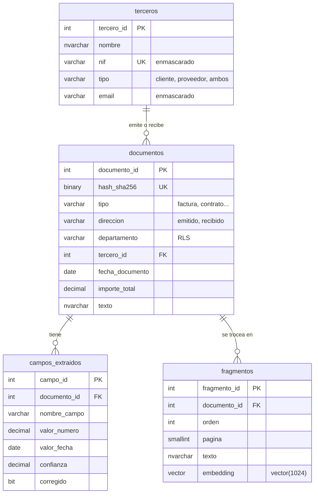

# Arquitectura

## Componentes

| Componente | Papel | Dónde |
|---|---|---|
| SQL Server 2025 | Datos, lógica, seguridad, vectores y orquestación de la IA | Instancia local (`.\SQL2025` o `localhost`) |
| Ollama | Ejecuta los modelos | `http://localhost:11434` |
| bge-m3 | Embeddings de 1024 dimensiones, multilingüe | Ollama |
| qwen3:4b-instruct | Clasificación, extracción de campos y respuestas RAG | Ollama |
| Caddy | Expone Ollama por HTTPS, que es lo único que acepta SQL Server | `https://localhost:11435` |
| App (.NET 9, Blazor en el servidor) | Interfaz: lee los PDF, guarda el original y llama a los procedimientos | `http://127.0.0.1:5080` |

Nada sale del ordenador.

## Modelo de datos



Además: `auditoria` (la llenan triggers), `consultas_rag` (traza de cada pregunta) y `config_ia` (modelos y URLs).

## Flujo 1: ingesta con IA

```
Texto del documento
   │  usp_archivar_documento        hash SHA-256: si ya existe, no se duplica
   ▼
documentos (tipo = sin_clasificar)
   │  usp_clasificar_y_extraer      qwen3:4b-instruct + JSON Schema -> JSON
   │                                T-SQL valida: tipos, fecha, base + IVA = total
   │                                fn_buscar_tercero: NIF o nombre aproximado (Jaro-Winkler)
   ▼
documentos + campos_extraidos
   │  usp_generar_embeddings        AI_GENERATE_CHUNKS (500 caracteres, 15 % solape)
   │                                AI_GENERATE_EMBEDDINGS (bge-m3), con cabecera tipo · tercero · archivo
   ▼
fragmentos (vector(1024))
```

## Flujo 2: RAG

```
Pregunta
   │  AI_GENERATE_EMBEDDINGS
   ▼
vector(1024)
   │  VECTOR_DISTANCE('cosine')     sobre fragmentos  (RLS: solo lo que el usuario puede ver)
   ▼
top-k fragmentos (distancia <= 0,60)
   │  contexto numerado [1] archivo · p. N  +  datos verificados (SQL)
   ▼
qwen3:4b-instruct vía sp_invoke_external_rest_endpoint
   │  "usa solo el contexto, cita [n], si no está di que no lo encuentras"
   ▼
Respuesta con citas  ──► consultas_rag (pregunta, documentos, contexto, respuesta, tiempo)
```

Si ningún fragmento supera el umbral, no se llama al modelo: se responde directamente que no hay información. Así el modelo no tiene ocasión de inventar.

## Flujo 3: preguntas de datos

El RAG no puede contar ni sumar todo el archivo: solo ve unos pocos fragmentos. Por eso `archivo.usp_preguntar` es un enrutador:

```
Pregunta
   │  usp_interpretar_pregunta      qwen3 + JSON Schema -> {tipo_pregunta, tercero, desde, hasta}
   │                                T-SQL valida el JSON (fechas, valores permitidos)
   ├── "contenido" ─────────────►   Flujo 2 (RAG): usp_preguntar_documentos
   ▼ "datos"
   │  usp_consultar_datos           tercero: contiene (sin tildes) · NIF · Jaro-Winkler
   │                                no existe o es ambiguo -> respuesta directa, sin modelo
   │                                COUNT, SUM y fechas por clase de documento (RLS aplicada)
   │                                cada clase dice qué es su importe: pagado, facturado, pactado
   ▼
datos calculados (texto con cifras ya formateadas) + lista de cifras permitidas
   │  usp_preguntar_datos           qwen3 redacta: "copia las cifras, no sumes ni redondees"
   │  fn_cifras_sin_respaldo        REGEXP_MATCHES saca cada número de la respuesta
   │                                ¿está en los datos o en la pregunta? si no, se descarta
   ▼
Respuesta en lenguaje natural ──► consultas_rag (intención, datos, respuesta, tiempo)
```

El modelo nunca escribe SQL: rellena un JSON con campos fijos y las consultas están escritas de antemano. Una pregunta que no encaja en esos campos no se responde con un cálculo inventado.

### Cuentas con las cifras

"El doble de lo pagado", "el 21 % de lo facturado", "la media por factura", "cuánto más que el año pasado": el modelo solo dice **qué** cuenta es; la **hace** T-SQL.

```
"¿Cuánto es el doble de lo que le he pagado a Arganzuela este año?"
   │  intérprete  -> operacion: multiplicar · valor: 2 · sobre: pagado
   ▼
fn_magnitud               lo pagado a ese tercero en el periodo: 145,20 EUR (RLS aplicada)
usp_calcular_operacion    145,20 × 2 = 290,40   -> línea para el modelo, fórmula y respuesta fija
   ▼
el modelo redacta         "Le has pagado 145,20 EUR; el doble son 290,40 EUR."
   ▼
comprobación              números en los datos · sin signos de operación · contiene 290,40
                          si falla algo -> respuesta fija calculada por SQL
```

Lista cerrada: multiplicar, dividir, porcentaje, sumar, restar, media por documento y comparar dos periodos, sobre lo pagado, lo facturado, los contratos o los presupuestos. Una cuenta fuera de la lista (`operacion: otra`, o palabras como "proyección" que detecta `fn_pide_calculo_extra` sin IA) se responde con "Ese cálculo no lo hago" y las cifras del archivo. Si no se puede hacer (dividir entre cero, no hay importes, monedas distintas), se dice por qué.

La app enseña la fórmula debajo de la respuesta: "Cuenta hecha por SQL Server · 145,20 EUR × 2 = 290,40 EUR".

Límite conocido: la comprobación de cifras mira que cada número exista en los datos, no que esté en la frase correcta. Si el modelo dijera "2 contratos" cuando hay 1 contrato y 2 facturas, el número 2 existe y pasaría. Con temperatura 0 y las cifras ya agrupadas no se ha visto, pero por eso la consulta guarda los datos calculados junto a la respuesta.

## La app

La app no tiene lógica de negocio propia: todo lo que decide (clasificar, buscar, calcular, permisos) sigue en los procedimientos. Hace tres cosas que T-SQL no puede hacer:

1. **Leer el PDF.** PdfPig extrae el texto página a página y lo une con marcas `[página N]` desde la segunda, el mismo formato que usa `fn_pagina_en` para citar páginas. Si apenas hay letras por página, es un escaneo y no se archiva.
2. **Guardar el original.** En `%LOCALAPPDATA%\Mnemos Archive\documentos\<sha256>.pdf`. El nombre lo decide la app (nunca el usuario) y la ruta solo se acepta si cumple ese formato, así que no se puede pedir otro archivo del disco.
3. **Enseñarlo.** Blazor en el servidor: la página y la conexión a SQL Server están en el mismo proceso, en este ordenador. Las respuestas largas del modelo (10–60 s) no bloquean la interfaz.

```
Navegador ──► App (127.0.0.1:5080) ──► SQL Server ──► Caddy ──► Ollama
   PDF ──► PdfPig ──► texto con [página N] ──► usp_archivar_documento (@archivo_local)
                  └─► carpeta local <sha256>.pdf
```

Decisiones (aprobadas antes de escribir código): .NET 9 con Blazor, web local en el navegador, PDF en una carpeta del disco con su nombre en la base de datos, y escaneos avisados sin OCR en esta versión.

"Ver como" ejecuta cada consulta con `EXECUTE AS USER = 'usr_contable' | 'usr_legal'` y `REVERT` en el mismo lote. El nombre sale de una lista cerrada en el código, nunca de lo que escribe el usuario, y esas conexiones no vuelven al pool, para que un error a mitad no deje una conexión suplantando a otro usuario.

## Seguridad

```
usr_admin    ─► rol_administracion  todo · UNMASK
usr_contable ─► rol_contabilidad    facturas, presupuestos, recibos · NIF/email enmascarados · sin DELETE
usr_legal    ─► rol_legal           solo contratos · sin columnas de contacto · sin DELETE
```

La política `archivo.politica_departamento` filtra `documentos`, `campos_extraidos` y `fragmentos`. Como la búsqueda y el RAG leen esas tablas, también quedan filtrados: el mismo `usp_preguntar` devuelve respuestas distintas según quién pregunte.
